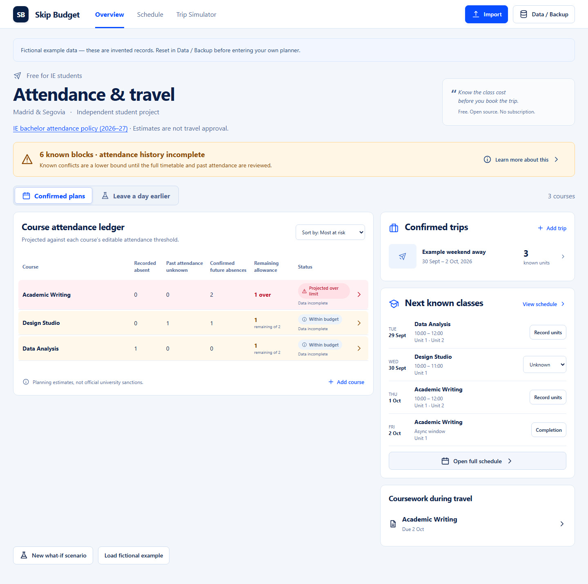

# Skip Budget

[](https://github.com/Alex-Kahwaji67/skip-budget-local/actions/workflows/checks.yml)

**Free, open-source attendance and travel planning for IE University students.**

Built from an exchange semester at IE in Madrid: before booking a trip, understand which numbered sessions, assessments, and deadlines it overlaps. One calendar block can contain two attendance units. An incomplete timetable cannot tell you that you are free.

For IE undergraduates and incoming exchange students in Madrid and Segovia. Independent and unaffiliated with IE University. Anyone can use, inspect, or adapt the code under the MIT license. Attendance planning should be available without a subscription.

This is the standalone local edition. No account, backend, API key, or subscription is required. Planner data stays in IndexedDB in your browser; JSON backups move it between devices manually.

**Free software, currently a local setup:** you need Node.js and the instructions below. There is no public one-click hosted app yet. See the [IE attendance and exchange guide](docs/IE_STUDENT_GUIDE.md) for sources, limits, and what to check before booking.



## Run locally

Install [Node.js](https://nodejs.org/) 22.12 or newer, then:

```sh
git clone https://github.com/Alex-Kahwaji67/skip-budget-local.git
cd skip-budget-local
npm ci
npm run dev
```

Open **http://127.0.0.1:5188** in a current Chrome, Edge, Firefox, or Safari browser. Use the same address and browser profile each time: browser storage belongs to an origin, including its port. Only one planner tab can edit at once; close it before opening another.

The planner starts empty. Select **Load fictional example** to try invented courses and travel near today's date. Reset it in **Data / Backup** before entering your own records. Loading examples, resetting, and restoring preserve one previous planner for recovery.

For a production build, run `npm run build`, then `npm run preview`. This serves the build on the same local address. Keep the local server running while using the app; this is not an installable offline PWA.

## Try it in two minutes

1. Load the fictional example. Notice the recorded absence and unknown past attendance are separate columns.
2. Select **Leave a day earlier**. Two additional Data Analysis units are projected; overlapping travel does not count Writing twice. Actual attendance stays unchanged.
3. Return to **Confirmed plans**. Select **Record units** for the next double block and record the units independently.
4. In **Trip Simulator**, analyze an alternative trip. Analysis does not save a trip or record attendance; **Save trip** is a separate action.
5. Export a backup in **Data / Backup**, reset the planner, then recover it. The recovery copy is local too, so keep the exported file somewhere safe.

See the [walkthrough](docs/WALKTHROUGH.md) and [development case study](docs/CASE_STUDY.md).

## What it handles

- Course-specific whole-unit attendance thresholds: `total units - ceil(total units × required attendance)`.
- Partial attendance in multi-unit blocks, unknown past records, conservative excused-absence treatment, and incomplete schedule warnings.
- Explicit attendance records for asynchronous sessions, separate from your completion checklist. Travelling never automatically marks asynchronous work absent.
- Confirmed travel, tentative trip comparisons, manual what-if skips, assessment conflicts, and asynchronous deadlines.
- Reviewed CSV/ICS imports with source identities, explicit course mapping, deduplication, and validation before saving.
- Validated JSON backup/restore, atomic reset/recovery, and export/retry when a local write fails.

All displayed times use **Europe/Madrid**, also the timezone for Segovia. New courses and fictional examples start with an editable 80% planning threshold. Example course names and totals are invented, not an IE course catalogue. Verify session totals against your syllabus. The app does not determine official sanctions, approve absences, or guarantee a trip is academically safe.

## Import a timetable

Use **Import** to upload or paste CSV/ICS text. The [CSV template](public/session-import-template.csv) contains fictional examples; map each row to a course you have created, or first load the example planner. Dates in the template are fixed examples, not your timetable.

ICS title suggestions recognize a limited Blackboard-style naming convention. Confirm the classification, course policy, and numbered units. Calendar snapshots do not sync. Recurrence rules, duration-only events, and all-day class events are deliberately blocked for manual resolution.

Files and pasted text are limited to **2 MiB**, imports to **2,000 rows/events**, and stored collections to **2,000 records each / 10,000 attendance units overall**. These are supported input limits, not measured capacity claims.

## Verify

```sh
npm test
npm run typecheck
npm run build
npx playwright install chromium
node tests/dev-startup.mjs
npm run test:browser
```

Browser tests launch their own production preview on port 5189 in disposable profiles. They exercise actual React and IndexedDB, including failed reads, aborted writes, retained-candidate export/retry, backups, imports, two-tab exclusion, trip analysis, and responsive layouts. No real accounts or personal files are used. GitHub Actions runs the same checks on Linux.

`npm run format:check` checks formatting. [Verification notes](docs/VALIDATION.md) distinguish automated checks from unmeasured real-world outcomes.

## Data and limitations

- **Export regularly.** Clearing site data, private browsing, storage eviction, or losing your browser profile can remove both the planner and its recovery copy. This edition does not read or migrate the earlier private edition's browser databases automatically.
- There is no automatic cross-device sync, hosted support inbox, telemetry, or login. Network access is needed to install dependencies; the running planner makes no third-party requests.
- Import only files you trust enough to inspect. Never post personal calendar files, calendar URLs, or backups in public issues. Use synthetic reproductions.
- Browser automation currently targets Chromium. Other listed browsers support the required APIs but have not received the same automated verification.
- No independent adoption, measured time savings, universal calendar compatibility, or formal security certification is claimed.

## Project structure

`src/domain.ts` contains the calculations; `src/importers.ts` stages and applies reviewed imports; `src/persistence.ts` validates documents and performs IndexedDB transactions; `src/App.tsx` coordinates local saves and screens. `src/seed.ts` generates fictional examples. The view components use ordinary React and native browser controls.

The public edition was curated from an earlier private hosted prototype. Account management and cloud infrastructure were removed to make the core tool independently runnable. AI coding tools assisted implementation, tests, and documentation; the case study records the product decisions and evidence boundaries.

## Contributing and license

Small bug fixes with a reproducible synthetic example are welcome. Run the checks above before opening a pull request. This is a personal project with no response-time or hosting commitment.

Code is available under the [MIT license](LICENSE). Screenshots show fictional data. This public edition includes no generated travel photographs or private operational logs.
