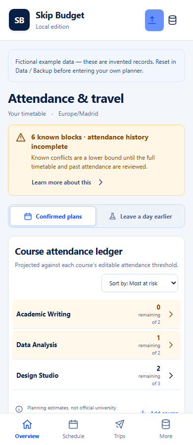

# Walkthrough using fictional data

Run the app with the README commands. The example generator creates invented records relative to today's Madrid date so the walkthrough does not depend on an expired semester.

1. **Load fictional example** and confirm. The example has three courses, six class blocks, two trips, one assessment, and one recorded absence. Schedule coverage remains explicitly incomplete.
2. In **Confirmed plans**, the example weekend projects one Design Studio unit and two Academic Writing units. The asynchronous reading deadline is listed separately. Data Analysis has a recorded absence; Design Studio has unknown past attendance.
3. Select **Leave a day earlier**. The hypothetical trip adds the two-unit Data Analysis block. The overlapping Writing block still counts only once. Return to Confirmed plans; no actual records have changed.
4. Select **Record units** for the next double block. Mark Unit 1 attended and Unit 2 absent, then save. Reload the page to check persistence.
5. Open **Trip Simulator**. Enter a name, departure, and return; choose a tentative status. **Analyze trip** is a preview. Only **Save trip** stores the trip, and neither action automatically records attendance.
6. For manual planned skips, create a **New what-if scenario**, select it, open a class from Schedule, and check the units to skip. Save the class draft. The scenario affects projections only.
7. In **Import**, paste or upload the fictional CSV template. Review and map the selected rows. Nothing is imported just by opening a preview. Unsupported or invalid rows must be corrected or left unselected.
8. Open **Data / Backup** and export JSON. Reset with recovery, then recover the previous planner. To move it to another browser, explicitly restore the exported file there.

Browser storage is tied to the browser profile and URL origin. Keep an exported backup before clearing data or switching devices. Reset the fictional example before entering your own records.
